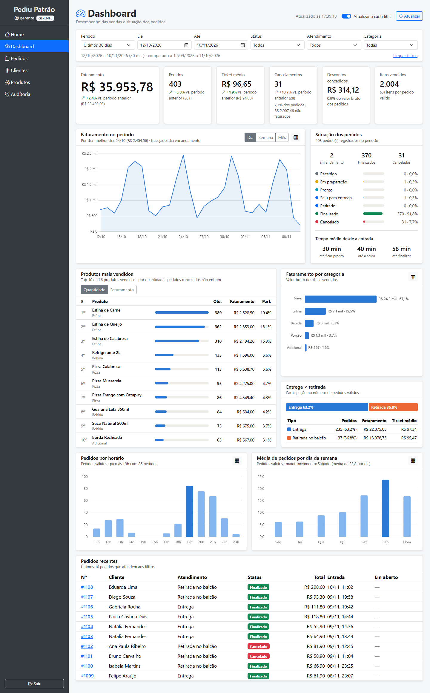
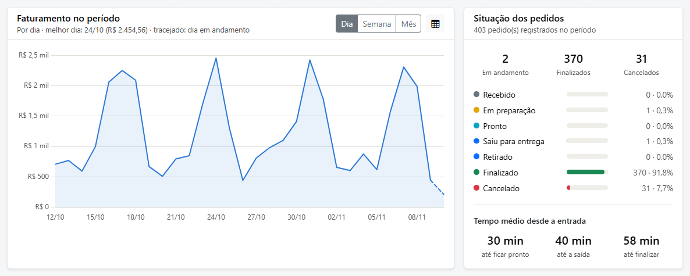
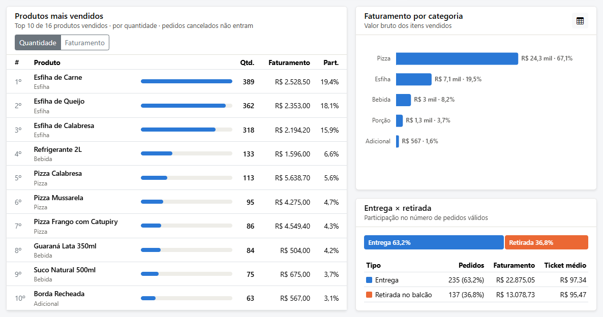
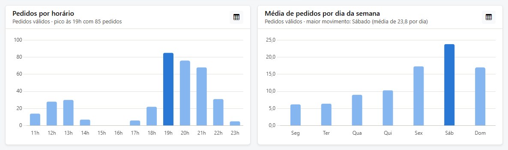
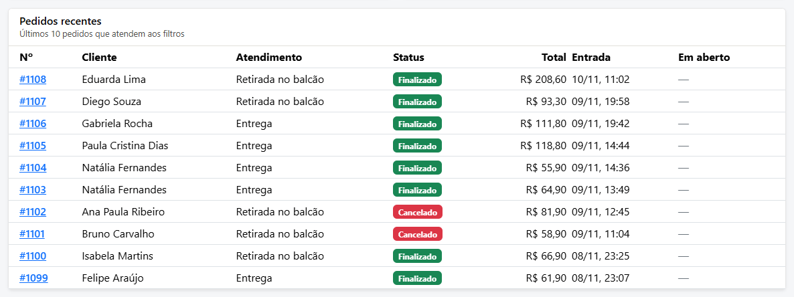
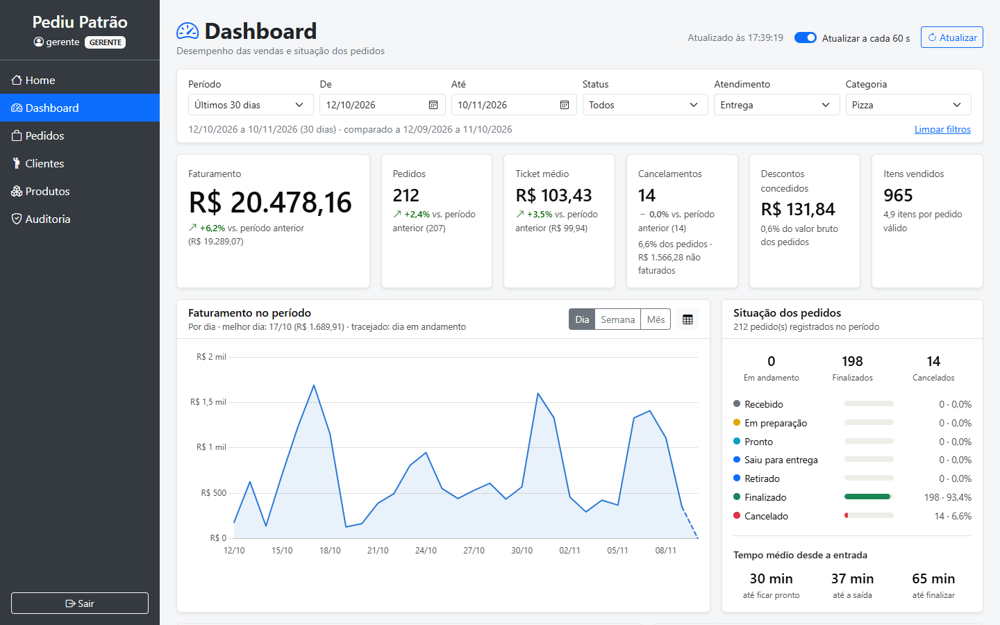
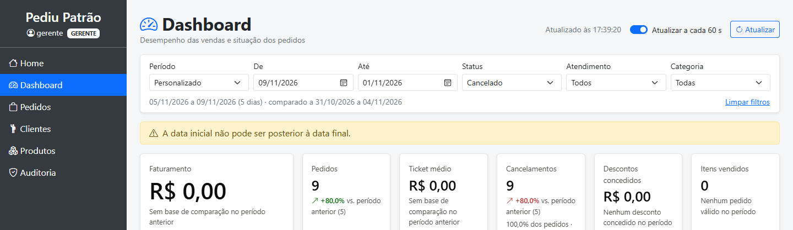
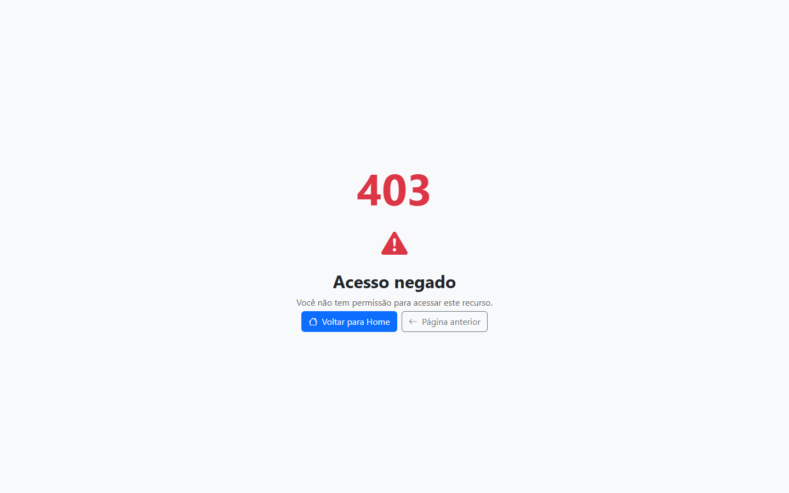
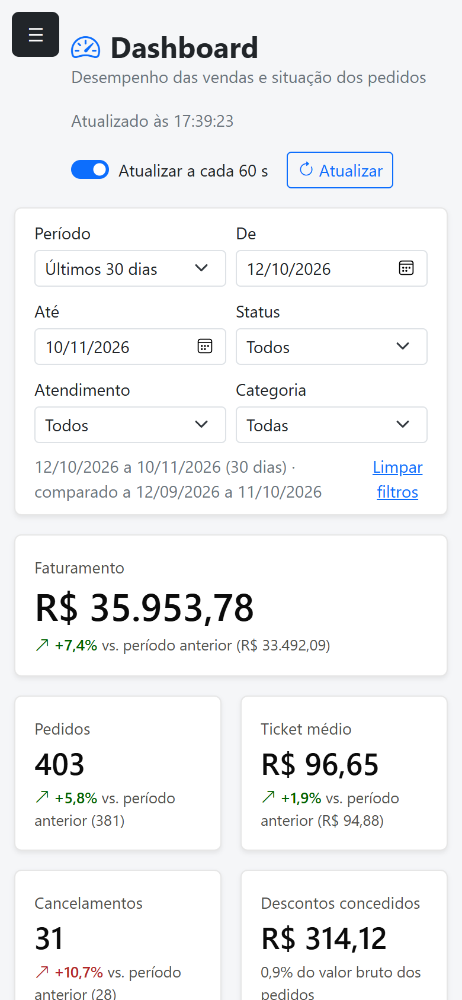

# 3. Evidências de testes

Os testes foram feitos em 10/11/2026 com Java 21.0.12.1, Spring Boot 3.4.4 e MongoDB 8 local (Windows 11).
A base tinha os dados de demonstração: **1.100 pedidos em 90 dias**, 16 produtos e 16 clientes fictícios.

| Tipo de teste | Quantidade | Resultado |
|---|---|---|
| [Testes automatizados (JUnit)](#31-testes-automatizados) | 153 | ✅ 153 aprovados, 0 falhas |
| [Testes da API com `curl`](#32-testes-da-api-com-curl) | 24 cenários | ✅ 24 com o status esperado |
| [Consistência entre endpoints](#33-consistência-entre-endpoints) | 10 verificações | ✅ todas conferem |
| [Desempenho](#34-desempenho) | 9 endpoints | ✅ de 6 a 13 ms em média (meta < 500 ms) |
| [Testes da interface](#35-testes-da-interface) | 16 cenários | ✅ todos conforme o esperado |

---

## 3.1 Testes automatizados

```bash
.\mvnw.cmd test
```

Resultado completo: [`evidencias/testes-automatizados.txt`](evidencias/testes-automatizados.txt).

```
[INFO] Results:
[INFO] Tests run: 153, Failures: 0, Errors: 0, Skipped: 0
[INFO] BUILD SUCCESS
```

### Testes criados para o dashboard (70 de 153)

| Classe | Testes | Tipo | O que verifica |
|---|---|---|---|
| `DashboardServiceTest` | 27 | Unitário (Mockito) | Período padrão e limites (366 dias, início > fim, categoria longa); cálculo do resumo e da comparação; período sem pedidos sem divisão por zero; lacunas da série; semana na segunda-feira; rótulo do mês; grupos **parciais**; 24 horas e média por dia da semana; status legados; ranking por quantidade e faturamento, com participação sobre o total; limite de 1 a 50; atendimento "não informado"; tempo em aberto só para pedidos em andamento |
| `DashboardRepositoryMongoTest` | 16 | Integração (MongoDB real) | As agregações rodam no MongoDB com 7 pedidos conhecidos. Verifica faturamento 277,52, cancelado 49,90, desconto 11,18 e 16 itens; o pedido das **23h30** fica no dia certo (fuso); agrupamento por semana e mês; horas locais; tempos médios 25,0 / 36,7 / 50,0 min; filtro de categoria sem diferenciar maiúsculas; filtros de status e atendimento; ordem dos recentes |
| `DashboardControllerTest` | 11 | Web (MockMvc + Spring Security) | `401` sem login; `403` para atendente; conversão dos parâmetros da URL (datas, lista de status, enums); padrões (`DIA`, `QUANTIDADE`, `limite` nulo); `400` para data mal formatada, status desconhecido, agrupamento inválido e regra do serviço; `POST` negado |
| `DashboardAutorizacaoTest` | 4 | Segurança (`@PreAuthorize`) | Segunda camada: mesmo chamando o serviço direto, o ATENDENTE e o anônimo são barrados, e o ADMIN e o GERENTE passam |
| `DashboardWebControllerTest` | 6 | Web (Thymeleaf renderizado) | `/dashboard` abre para o gerente e o admin, dá `403` ao atendente e redireciona o anônimo ao login; o atalho do menu aparece ou some conforme o perfil |
| `GeradorPedidosDemonstracaoTest` | 6 | Unitário | Os dados de demonstração respeitam as regras do sistema (fluxo de status, saída, desconto ≤ 20%, justificativa), são determinísticos e têm proporções realistas |

O `DashboardRepositoryMongoTest` usa o banco **separado** `pediupatrao_teste_dashboard`, que é apagado a cada teste, e nunca toca no banco da aplicação.
Se não houver MongoDB em `127.0.0.1:27017`, o teste é **ignorado** (*skipped*) em vez de falhar.

### Testes que já existiam (83)

`StatusPedidoTest` (19), `PedidoServiceTest` (18), `SegurancaHttpTest` (18), `AutorizacaoServicosTest` (10), `AuditoriaServiceTest` (7), `UsuarioServiceTest` (6) e `ClienteServiceTest` (5). Todos continuam passando: o dashboard não alterou nenhuma regra existente.

---

## 3.2 Testes da API com `curl`

Executados com a aplicação rodando (`http://localhost:8080`) e autenticação HTTP Basic.
`P` = `inicio=2026-11-03&fim=2026-11-09`.

| ID | Requisição | Usuário | Esperado | Obtido | Corpo (resumo) |
|---|---|---|---|---|---|
| E-01 | `GET /filtros` | gerente | 200 | ✅ 200 | 7 status, 2 atendimentos, 5 categorias, período padrão de 30 dias |
| E-02 | `GET /resumo?P` | gerente | 200 | ✅ 200 | faturamento 8.406,46 · 96 pedidos · ticket 97,75 · −8,2% |
| E-03 | `GET /vendas?P&agrupamento=DIA` | gerente | 200 | ✅ 200 | 7 pontos, de 03/11 a 09/11 |
| E-04 | `GET /vendas?inicio=2026-10-08&fim=2026-11-10&agrupamento=SEMANA` | gerente | 200 | ✅ 200 | 6 semanas; a primeira e a última com `parcial: true` |
| E-05 | `GET /vendas/por-horario?P` | gerente | 200 | ✅ 200 | 24 horas, pico às 19h, dia de pico sábado |
| E-06 | `GET /vendas/por-categoria?P` | gerente | 200 | ✅ 200 | Pizza 69,05%, Esfiha 19,09%… |
| E-07 | `GET /vendas/por-atendimento?P` | gerente | 200 | ✅ 200 | Entrega 69,77% dos pedidos |
| E-08 | `GET /pedidos/status?P` | gerente | 200 | ✅ 200 | 86 finalizados, 10 cancelados; tempos 30,2 / 39,7 / 59,7 min |
| E-09 | `GET /pedidos/recentes?P&limite=3` | gerente | 200 | ✅ 200 | 3 pedidos (#1107, #1106, #1105), do mais novo para o mais antigo |
| E-10 | `GET /produtos/mais-vendidos?P&criterio=FATURAMENTO&limite=5` | **admin** | 200 | ✅ 200 | Top 5, com Pizza Calabresa em 1º (R$ 1.447,10) |
| E-11 | `GET /resumo?P&status=FINALIZADO&status=CANCELADO&tipoAtendimento=ENTREGA&categoria=Pizza` | gerente | 200 | ✅ 200 | 54 pedidos, 5 cancelados (filtros combinados) |
| E-12 | `GET /resumo` | — (sem login) | 401 | ✅ 401 | `Autenticação necessária para acessar este recurso.` |
| E-13 | `GET /resumo` | **atendente** | 403 | ✅ 403 | `O perfil ATENDENTE não tem permissão para esta operação.` |
| E-14 | `GET /resumo?inicio=2026-11-09&fim=2026-11-03` | gerente | 400 | ✅ 400 | `campos.inicio`: data inicial posterior à final |
| E-15 | `GET /resumo?inicio=09/11/2026` | gerente | 400 | ✅ 400 | `campos.inicio`: `Valor inválido: 09/11/2026` |
| E-16 | `GET /resumo?inicio=2025-01-01&fim=2026-11-09` | gerente | 400 | ✅ 400 | `campos.fim`: período maior que 366 dias |
| E-17 | `GET /vendas?agrupamento=ANO` | gerente | 400 | ✅ 400 | `campos.agrupamento`: `Valor inválido: ANO` |
| E-18 | `GET /produtos/mais-vendidos?limite=500` | gerente | 400 | ✅ 400 | `campos.limite`: deve estar entre 1 e 50 |
| E-19 | `GET /resumo?status=ENTREGUE` | gerente | 400 | ✅ 400 | `campos.status`: `Valor inválido: ENTREGUE` |
| E-20 | `GET /resumo?categoria=xxxx…` (61 caracteres) | gerente | 400 | ✅ 400 | `campos.categoria`: no máximo 60 caracteres |
| E-21 | `POST /resumo` | gerente | 403 | ✅ 403 | `Token CSRF ausente ou inválido.` |
| E-22 | `GET /produtos/mais-vendidos?criterio=LUCRO` | gerente | 400 | ✅ 400 | `campos.criterio`: `Valor inválido: LUCRO` |
| E-23 | `GET /resumo` (sem filtros) | gerente | 200 | ✅ 200 | Últimos 30 dias: 403 pedidos, R$ 35.953,78 |
| E-24 | `GET /resumo?tipoAtendimento=DRIVE` | gerente | 400 | ✅ 400 | `campos.tipoAtendimento`: `Valor inválido: DRIVE` |

Os corpos completos das respostas de sucesso estão na [documentação da API](02-api-dashboard.md), e todos os corpos de erro seguem o [formato padrão](02-api-dashboard.md#formato-de-erro).

---

## 3.3 Consistência entre endpoints

Cada endpoint faz a sua própria agregação. Para garantir que todos contam a mesma coisa, os totais do período `P` (03/11 a 09/11/2026) foram cruzados:

| # | Verificação | Cálculo | Confere |
|---|---|---|---|
| 1 | Soma do faturamento diário (`/vendas`) = faturamento do `/resumo` | 603,20 + 875,21 + 619,90 + 1.570,44 + 2.306,91 + 1.986,10 + 444,70 = **8.406,46** | ✅ |
| 2 | Soma dos pedidos diários = `totalPedidos` | 8 + 11 + 9 + 18 + 25 + 18 + 7 = **96** | ✅ |
| 3 | Soma dos cancelados diários = `pedidosCancelados` | 0 + 1 + 1 + 2 + 3 + 1 + 2 = **10** | ✅ |
| 4 | Status finalizado + cancelado = total | 86 + 10 = **96** | ✅ |
| 5 | Valor dos finalizados (`/pedidos/status`) = faturamento | **8.406,46** = 8.406,46 | ✅ |
| 6 | Valor dos cancelados (`/pedidos/status`) = `valorCancelado` | **1.039,36** = 1.039,36 | ✅ |
| 7 | Entrega + retirada = pedidos válidos e faturamento | 60 + 26 = **86**; 5.970,39 + 2.436,07 = **8.406,46** | ✅ |
| 8 | Pedidos por hora e por dia da semana = pedidos válidos | Σ horas = **86**; 5 + 8 + 10 + 8 + 16 + 22 + 17 = **86** | ✅ |
| 9 | Categoria (bruto) − descontos = faturamento | 8.485,90 − 79,44 = **8.406,46** | ✅ |
| 10 | Ticket médio = faturamento ÷ pedidos válidos | 8.406,46 ÷ 86 = **97,75** | ✅ |

---

## 3.4 Desempenho

Tempo médio de 5 chamadas por endpoint, com sessão (sem o custo do BCrypt do HTTP Basic), sobre o **período máximo de 366 dias** (todos os 1.100 pedidos):

| Endpoint | Tempo médio |
|---|---|
| `/resumo` | 9,7 ms |
| `/vendas` (semana) | 9,0 ms |
| `/vendas/por-horario` | 8,6 ms |
| `/vendas/por-categoria` | 9,6 ms |
| `/vendas/por-atendimento` | 6,3 ms |
| `/pedidos/status` | 12,6 ms |
| `/pedidos/recentes` | 8,1 ms |
| `/produtos/mais-vendidos` | 11,3 ms |
| `/filtros` | 5,5 ms |

Com HTTP Basic, cada chamada leva cerca de 65 ms. A diferença vem da verificação da senha com BCrypt a cada requisição, que é intencionalmente lenta, e não das consultas.
A tela dispara as 9 requisições em paralelo, então o tempo de carga dos dados fica próximo ao do endpoint mais lento.

---

## 3.5 Testes da interface

Executados no navegador com o usuário `gerente` (e `atendente` para o controle de acesso).
As capturas foram geradas com os dados de demonstração.

| ID | Cenário | Passos | Resultado esperado | Resultado |
|---|---|---|---|---|
| T-01 | Visão geral | Abrir `/dashboard` | Os 9 painéis carregam com dados dos últimos 30 dias | ✅ [01](evidencias/telas/01-dashboard-visao-geral.png) |
| T-02 | Indicadores | Conferir os cartões | Valores e variações iguais ao `/resumo`; cancelamento em vermelho com seta | ✅ [02](evidencias/telas/02-indicadores-e-filtros.png) |
| T-03 | Tooltip e crosshair | Passar o mouse no gráfico de faturamento | Linha vertical, valor do dia, pedidos, ticket e cancelados | ✅ |
| T-04 | Agrupamento | Clicar em **Semana** | Série semanal; a semana atual aparece tracejada e o subtítulo explica | ✅ [04](evidencias/telas/04-vendas-por-semana.png) |
| T-05 | Visão em tabela | Clicar no ícone de tabela | O gráfico vira uma tabela com os mesmos números, e a semana parcial vem marcada "(parcial)" | ✅ [05](evidencias/telas/05-vendas-visao-tabela.png) |
| T-06 | Ranking | Alternar **Quantidade/Faturamento** | A ordem e a coluna de participação mudam | ✅ [09](evidencias/telas/09-ranking-por-faturamento.png) |
| T-07 | Filtros combinados | Categoria Pizza + Entrega | Todos os painéis recalculam; a URL recebe `categoria=Pizza&tipoAtendimento=ENTREGA` | ✅ [10](evidencias/telas/10-filtro-pizza-entrega.png) |
| T-08 | Filtro de status | Período personalizado + status Cancelado | Faturamento R$ 0,00, "sem base de comparação" e painéis de vendas com "Nenhuma venda no período" | ✅ [11](evidencias/telas/11-filtro-status-cancelado.png) |
| T-09 | Validação do período | Início 09/11 e fim 01/11 | Aviso "A data inicial não pode ser posterior à data final." e os dados anteriores mantidos | ✅ [12](evidencias/telas/12-validacao-periodo-invalido.png) |
| T-10 | Período "Hoje" | Selecionar **Hoje** | Indicadores do dia, com comparação a ontem | ✅ |
| T-11 | Limpar filtros | Clicar em **Limpar filtros** | Volta aos últimos 30 dias, e a URL fica só com `?periodo=30` | ✅ |
| T-12 | URL compartilhável | Recarregar a página com filtros na URL | Os filtros são restaurados | ✅ |
| T-13 | Celular | Largura de 390 px | Filtros em 2 colunas, cartões empilhados, sem rolagem horizontal | ✅ [13](evidencias/telas/13-mobile-topo.png) |
| T-14 | Acesso do atendente | Entrar como atendente e abrir `/dashboard` | Página **403 Acesso negado** | ✅ [14](evidencias/telas/14-atendente-acesso-negado.png) |
| T-15 | Menu por perfil | Comparar a home do atendente e a do gerente | O atalho "Dashboard" só aparece para ADMIN e GERENTE | ✅ [15](evidencias/telas/15-home-atendente-sem-atalho.png) · [16](evidencias/telas/16-home-gerente-com-atalho.png) |
| T-16 | Console do navegador | Navegar por todos os filtros | Nenhum erro de JavaScript | ✅ |

### Capturas

**Visão geral (últimos 30 dias)**



**Faturamento por dia e situação dos pedidos.** O último dia, ainda em andamento, aparece tracejado.



**Ranking, categorias e entrega × retirada**



**Horários de pico e média por dia da semana**



**Pedidos recentes**



**Filtros aplicados: Pizza + Entrega**



**Validação de período inválido**



**Atendente sem acesso**



**Celular (390 px)**


