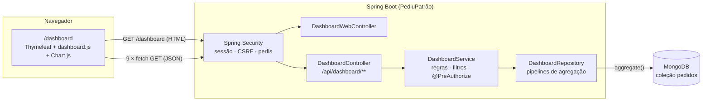
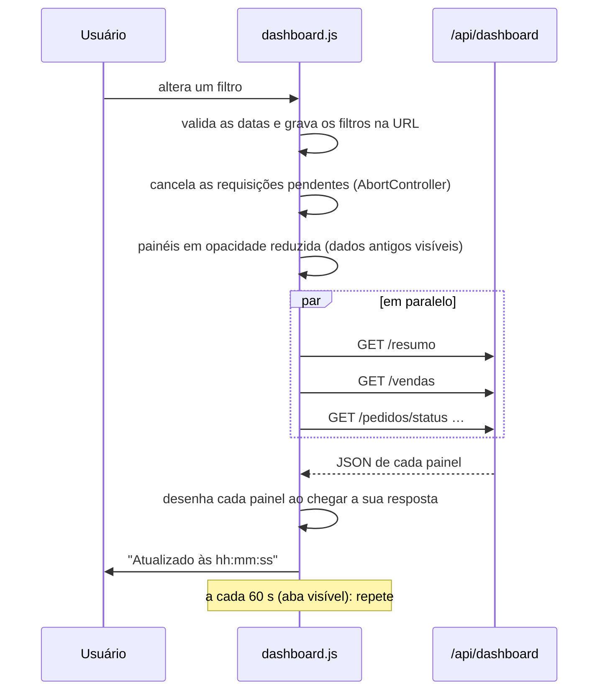
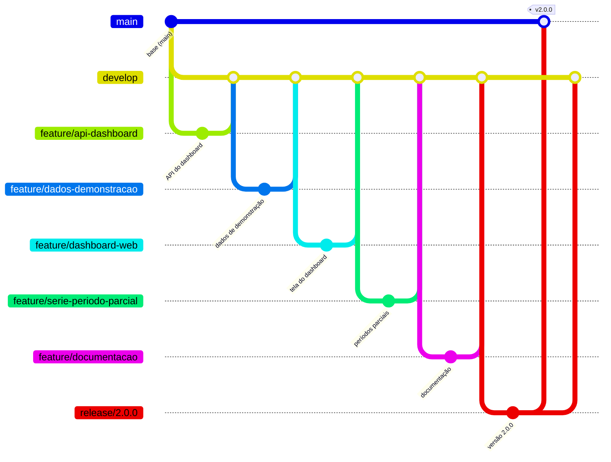

# 4. Análise e projeto

Este documento registra **como** o dashboard foi construído e **por que** cada decisão foi tomada.

## 4.1 Arquitetura



| Camada | Responsabilidade |
|---|---|
| `DashboardWebController` | Entrega a página; não calcula nada. A tela não recebe dados do servidor pelo Thymeleaf |
| `DashboardController` | Traduz a URL em parâmetros (`FiltroDashboardParams`) e devolve os DTOs em JSON |
| `DashboardService` | Valida e normaliza os filtros, aplica as regras de negócio (período anterior, ticket médio, médias, lacunas, grupos parciais) e monta as respostas. Exige `ADMIN` ou `GERENTE` em todos os métodos |
| `DashboardRepository` | Executa as agregações no MongoDB e devolve números brutos |
| DTOs (`record`) | Contrato da API: imutável, um por endpoint, sem expor a entidade `Pedido` |

### Por que o dashboard fica dentro do próprio sistema

- **Reaproveita a segurança:** o mesmo login, os mesmos perfis, o CSRF e a auditoria. Um front separado exigiria CORS, tokens e outro login.
- **Sem build de front-end:** o projeto já usava Thymeleaf e Bootstrap. O dashboard é uma página com JavaScript puro e Chart.js via CDN, que qualquer integrante consegue manter.
- **A API continua independente:** toda a informação vem de `/api/dashboard/**` em JSON. Outro cliente, como um app ou um BI, poderia consumir os mesmos endpoints sem mudança.

---

## 4.2 Dados de origem

O dashboard **não criou coleções novas**: ele lê os campos que o `Pedido` já registrava.

| Campo do pedido | Usado em |
|---|---|
| `dataHoraEntrada` | Filtro de período, série temporal, hora e dia da semana, ordem dos recentes |
| `status` | Situação dos pedidos, separação entre faturamento e cancelamento |
| `valorTotal`, `valorDesconto` | Faturamento, ticket, valor cancelado, descontos |
| `tipoAtendimento` | Entrega × retirada e o filtro de atendimento |
| `itens[]` (`produtoId`, `nomeProduto`, `tipoProduto`, `quantidade`, `subtotal`) | Ranking, categorias, itens vendidos e o filtro de categoria |
| `historico[]` (`statusNovo`, `dataHora`) | Tempo até ficar pronto |
| `dataHoraSaida`, `dataHoraFinalizacao` | Tempo até a saída e até a finalização |
| `clienteNome`, `numero` | Pedidos recentes |

Para as consultas por período, foram criados dois **índices** (`MongoInitConfig`):

| Índice | Campos | Atende |
|---|---|---|
| `ix_dataHoraEntrada` | `dataHoraEntrada: -1` | Todas as consultas filtram pelo período, e os recentes ordenam por ele |
| `ix_status_dataHoraEntrada` | `status: 1, dataHoraEntrada: -1` | Consultas com filtro de status |

---

## 4.3 Projeto da API

### Um endpoint por painel

**Alternativa considerada:** um único `GET /api/dashboard` devolvendo tudo de uma vez.
**Decisão:** separar os endpoints por recurso (`resumo`, `vendas`, `pedidos`, `produtos`) pelos seguintes motivos:

1. **Carregamento em paralelo e falha isolada:** se o ranking falhar, os indicadores continuam na tela.
2. **Parâmetros próprios:** `agrupamento` só faz sentido em `/vendas`, e `criterio` e `limite` só no ranking. Ao trocar "Dia" por "Semana", a tela refaz **uma** requisição, e não nove.
3. **Reuso:** cada endpoint responde a uma pergunta de negócio e pode ser usado sozinho por outro cliente.
4. **Testabilidade:** cada agregação tem os seus testes.

### Contrato

- **Somente `GET`:** o dashboard é leitura. Rotas de escrita não existem, e a segurança nega qualquer outro método.
- **Os mesmos filtros em todos os endpoints** (`inicio`, `fim`, `status`, `tipoAtendimento` e `categoria`), com a mesma validação centralizada em `DashboardService.resolverFiltro`. Assim, não há como dois painéis usarem períodos diferentes.
- **Respostas autoexplicativas:** cada uma devolve o `periodo` efetivamente usado. Isso importa quando o cliente omite as datas, que assumem o padrão de 30 dias.
- **Valores prontos para exibir, mas sem formatação:** percentuais já calculados (0–100) e rótulos de eixo (`03/11`, `nov/2026`), mas números como números. Formatar em reais é tarefa do cliente.
- **Erros padronizados**, com `campos` indicando qual parâmetro está errado. O formato é o mesmo das outras APIs do sistema.
- **Limites explícitos** contra consultas abusivas: período de no máximo 366 dias e `limite` de no máximo 50. Os valores ficam expostos em `/filtros`.

---

## 4.4 Agregações no MongoDB

Toda a conta é feita **no banco**. A aplicação nunca carrega a lista de pedidos para somar em Java: com milhares de pedidos, isso consumiria memória e rede à toa.

Exemplo: o pipeline do `/resumo` (`DashboardRepository.totais`), em uma única passada:

```js
db.pedidos.aggregate([
  { $match: {
      dataHoraEntrada: { $gte: ISODate("2026-11-03T03:00:00Z"), $lt: ISODate("2026-11-10T03:00:00Z") }
  } },
  { $group: {
      _id: null,
      pedidos:        { $sum: 1 },
      cancelados:     { $sum: { $cond: [{ $eq: ["$status", "CANCELADO"] }, 1, 0] } },
      faturamento:    { $sum: { $cond: [{ $eq: ["$status", "CANCELADO"] }, 0, { $convert: { input: "$valorTotal", to: "decimal", onError: 0, onNull: 0 } }] } },
      valorCancelado: { $sum: { $cond: [{ $eq: ["$status", "CANCELADO"] }, { $convert: { input: "$valorTotal", to: "decimal", onError: 0, onNull: 0 } }, 0] } },
      descontos:      { $sum: { $cond: [{ $eq: ["$status", "CANCELADO"] }, 0, { $convert: { input: "$valorDesconto", to: "decimal", onError: 0, onNull: 0 } }] } },
      itensVendidos:  { $sum: { $cond: [{ $eq: ["$status", "CANCELADO"] }, 0,
                        { $sum: { $map: { input: { $ifNull: ["$itens", []] }, as: "item", in: { $ifNull: ["$$item.quantidade", 0] } } } }] } }
  } }
])
```

| Técnica | Onde | Por quê |
|---|---|---|
| `$convert` para `decimal` | Todos os valores | O Spring Data grava `BigDecimal` como **texto** (`"93.30"`). Somar texto não funciona, e somar `double` perde centavos. `decimal` é exato, e `onError`/`onNull: 0` protegem contra pedidos antigos incompletos |
| `$cond` dentro do `$group` | Resumo e série | Calcula faturamento e cancelamento na **mesma** passada, sem duas consultas |
| `$dateTrunc` com `timezone` e `startOfWeek: "monday"` | Série por dia, semana e mês | O MongoDB guarda as datas em UTC. Sem o fuso, um pedido às 23h30 de sábado cairia no domingo. O repositório usa o mesmo fuso com que o Spring Data converte o `LocalDateTime` ao gravar, então o horário agrupado é exatamente o registrado no pedido |
| `$hour` e `$isoDayOfWeek` com `timezone` | Horários | Mesmo motivo: o pico das 19h tem que ser 19h no horário local |
| `$facet` | Horários | Hora e dia da semana numa única leitura dos documentos |
| `$unwind: "$itens"` + `$addToSet: "$_id"` | Produtos e categorias | Soma por item, mas conta **pedidos distintos**: duas pizzas no mesmo pedido contam como 1 pedido |
| `$filter`/`$let` sobre `historico` | Tempo até pronto | A data de "pronto" não é um campo do pedido; ela é tirada do histórico de status |
| `$regex` ancorada e sem diferenciar maiúsculas | Categoria | `pizza`, `Pizza` e `PIZZA` são a mesma categoria. O texto passa por `Pattern.quote`, então não há injeção de regex |

O que fica no **Java** (`DashboardService`) é o que não é agregação: preencher dias sem venda com zero, marcar grupos parciais, calcular a variação contra o período anterior, a média por ocorrência do dia da semana, as participações percentuais e a normalização de status legados.

---

## 4.5 Definições de negócio

Essas regras foram decididas na análise e valem para todos os painéis:

| Decisão | Justificativa |
|---|---|
| **O faturamento exclui os cancelados**, que aparecem à parte (quantidade, taxa e valor) | O dinheiro de um pedido cancelado não entrou. Mostrar o cancelado à parte transforma a perda num indicador acompanhável |
| O **ticket médio** divide pelos pedidos **válidos** | Dividir pelos pedidos totais baixaria o ticket artificialmente a cada cancelamento |
| A **comparação** é com o período anterior de mesma duração | Comparar 7 dias com 30 dias não faz sentido. Usar a mesma duração imediatamente antes é o padrão mais intuitivo ("vs. semana passada") |
| `variacaoPercentual = null` quando a base é zero | Evita "+∞%". A tela mostra "sem base de comparação" |
| Os gráficos de categoria e produto usam o **valor bruto** dos itens | O desconto é dado no pedido inteiro. Ratear por item seria uma convenção arbitrária, e a diferença é exatamente o total de descontos (ver evidência §3.3, item 9) |
| A média por dia da semana divide pelo **número de ocorrências** | Em 30 dias pode haver 5 sábados e 4 segundas. Somar sem dividir favoreceria quem aparece mais vezes |
| Os grupos incompletos são marcados como `parcial` | A semana atual tem só alguns dias. Sem a marcação, o gráfico mostraria uma "queda" que não existe |
| O filtro de categoria seleciona pedidos com **ao menos um item** da categoria | Responde a "como estão os pedidos que têm pizza?". No ranking e nas categorias, só os itens daquela categoria entram |
| "Em andamento" = Recebido, Em preparação, Pronto, Saiu para entrega e Retirado | São os pedidos que ainda exigem ação da equipe. Recentes abertos há mais de 60 min são sinalizados como atrasados |
| Os status antigos são convertidos (`ENTREGUE` → `FINALIZADO`, `EM_PREPARO` → `EM_PREPARACAO`) | Pedidos de versões anteriores do sistema continuam contando no status certo |

---

## 4.6 Front-end

**Tecnologia:** Thymeleaf (layout do sistema), JavaScript puro em `static/js/dashboard.js` e Chart.js 4.4.7.

### Fluxo de atualização



### Decisões de visualização

| Decisão | Motivo |
|---|---|
| Faturamento em **número grande** e os demais indicadores em cartões menores | É o número que o dono procura primeiro; os outros explicam o resultado |
| **Linha** para a série temporal; **barras horizontais** para categorias e ranking; **colunas** para hora e dia | Linha mostra tendência; barras comparam grandezas, e as horizontais acomodam nomes longos |
| Barra **segmentada** (e não pizza) para entrega × retirada | Duas partes de um todo são lidas com mais precisão em comprimento do que em ângulo |
| **Um eixo por gráfico**, nunca dois eixos Y | Dois eixos com escalas diferentes induzem correlações falsas. Pedidos e faturamento aparecem no tooltip ou em gráficos separados |
| Só o pico em azul forte; as demais barras em azul claro | Destaca a resposta ("19h", "sábado") sem legenda extra |
| Paleta **validada** para contraste e daltonismo: azul `#2a78d6`, azul claro `#86b6ef` e laranja `#eb6834` | O par azul/laranja continua distinguível para os principais tipos de daltonismo, e o contraste sobre o fundo branco foi verificado |
| Status com **cor, ícone e rótulo** | A cor nunca é o único sinal (acessibilidade) |
| Botão de **tabela** em cada gráfico | Permite ler os números exatos e atende leitores de tela |
| Período parcial **tracejado** | Mostra a semana corrente sem sugerir uma queda |
| Textos inseridos com `textContent` | Nomes de clientes e produtos nunca são interpretados como HTML (proteção contra XSS) |
| Sem Chart.js (CDN fora do ar), o dashboard abre as tabelas | O dashboard continua útil mesmo sem a biblioteca de gráficos |

---

## 4.7 Segurança

| Ameaça | Proteção |
|---|---|
| Atendente vendo faturamento | Regra de URL `GET /dashboard` e `/api/dashboard/**` → `hasAnyRole('ADMIN','GERENTE')` **e** `@PreAuthorize` no serviço (duas camadas) |
| Usuário anônimo | `401` na API e redirecionamento ao login na tela |
| Escrita pela API | Só `GET` é liberado, e o resto cai em `denyAll`; o CSRF continua ativo |
| Consultas pesadas de propósito | Período de no máximo 366 dias e limite de no máximo 50 |
| Injeção na consulta | Os parâmetros são tipados (datas, enums), e a categoria é escapada com `Pattern.quote` e limitada a 60 caracteres |
| Exposição de dados pessoais | Os recentes mostram só o nome do cliente |
| Tentativas indevidas | Os `403` vão para a auditoria, com usuário, perfil e rota |

---

## 4.8 Gitflow



| Branch | Conteúdo |
|---|---|
| `main` | Versões publicadas. Recebe apenas merges de `release/*`, com tag |
| `develop` | Integração das funcionalidades |
| `feature/api-dashboard` | **Implementação da API**: DTOs, repositório de agregações, serviço, controller, índices e testes |
| `feature/dados-demonstracao` | Gerador opcional de pedidos realistas para demonstração |
| `feature/dashboard-web` | Tela `/dashboard`, CSS, JavaScript e menu |
| `feature/serie-periodo-parcial` | Ajuste da API e do gráfico para períodos incompletos |
| `feature/documentacao` | Esta documentação e as evidências |
| `release/2.0.0` | Versão do projeto ajustada para 2.0.0 e verificação final |
| `hotfix/2.0.1` | Ajuste pontual na documentação publicada, integrado à `main` (tag `v2.0.1`) e à `develop` |

Todos os merges usam `--no-ff`, para que cada funcionalidade fique visível no histórico.

---

## 4.9 Dados de demonstração

Com a base vazia, o dashboard não teria o que mostrar. Por isso, foi criado um gerador **opcional** (`APP_DEMO_ENABLED=true`), que fica **desligado por padrão**:

- gera 90 dias de pedidos (cerca de 1.100) com a semente fixa `2026`, ou seja, os mesmos dados em toda máquina;
- simula o movimento real: mais pedidos de sexta a domingo, picos no almoço e entre 19h e 21h, 62% de entregas e produtos com popularidade diferente;
- respeita as regras do sistema: fluxo de status completo com responsáveis e horários, descontos de até 15% e cancelamentos com justificativa, ambos pelo gerente;
- os pedidos do dia atual ficam em andamento, como numa operação real;
- só roda quando há menos de 100 pedidos, então nunca duplica dados.

---

## 4.10 Limitações e melhorias futuras

| Limitação atual | Possível evolução |
|---|---|
| O desconto não é rateado por item | Gravar o desconto proporcional em cada item no momento do pedido |
| O filtro de status compara os status atuais. Pedidos gravados com status antigos aparecem na contagem, mas não no filtro | Migrar os status antigos no banco |
| Atualização a cada 60 s (*polling*) | WebSocket ou Server-Sent Events para pedidos em tempo real |
| Sem exportação | Exportar CSV ou PDF dos painéis |
| Comparação apenas com o período anterior | Opção "mesmo período do ano passado" |
